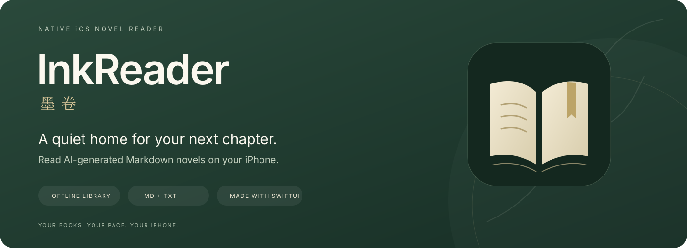
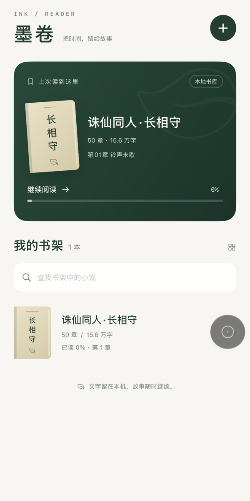
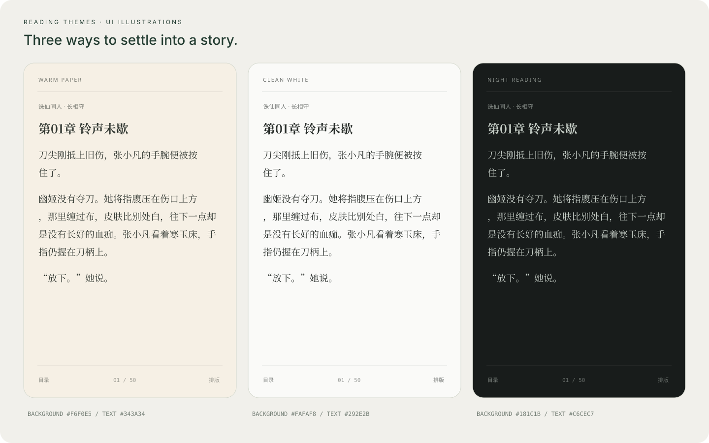
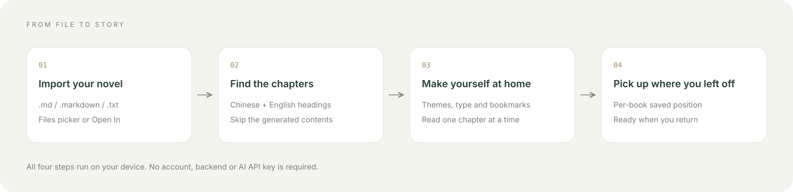

<p align="center">
  
</p>

<p align="center">
  
  
  
  
</p>

<p align="center">
  <b>A native iOS reader for AI-generated Markdown novels.</b><br>
  An offline bookshelf, comfortable typography, and a place to return to every story.
</p>

<p align="center">
  English · <a href="README.zh-CN.md">简体中文</a><br><br>
  <a href="#a-look-inside">Preview</a> ·
  <a href="#features">Features</a> ·
  <a href="#getting-started">Getting started</a> ·
  <a href="#reading-your-first-book">Usage</a> ·
  <a href="#development">Development</a>
</p>

## Meet InkReader


Long stories deserve a comfortable place to read. InkReader turns Markdown and plain-text novels into a chapter-based reading experience on iPhone, with a local library, saved reading positions, bookmarks, and adjustable typography.

Bring a novel from your favorite writing tool, open it on your phone, and settle into the next chapter. No account, server, or AI API key is required. InkReader is a reader; novel generation happens in the writing tool of your choice.

The current app interface is in **Simplified Chinese**. The chapter parser recognizes both Chinese and English chapter headings.

## A look inside

<table>
  <tr>
    <td width="42%" align="center">
      
    </td>
    <td width="58%" valign="top">
      <h3>Your stories, together</h3>
      <p>An evergreen reading card keeps your current book close. The bookshelf lets you choose another novel whenever you like.</p>
      <p><b>Continue reading</b><br>Return to the saved chapter and scroll position for each book.</p>
      <p><b>Bring your own files</b><br>Import Markdown or TXT documents with the system Files picker, including multiple books at once.</p>
      <p><b>Start with a complete novel</b><br>The bundled example, 《诛仙同人·长相守》, contains 50 chapters and 156,176 Chinese characters in the body text.</p>
      <p><sub>Actual screenshot from an iPhone 17 Pro Max. System status and home-indicator areas have been cropped.</sub></p>
    </td>
  </tr>
</table>

### Settle into your favorite reading theme



<p align="center"><sub>Theme illustrations based on the implemented colors and reading layout; these are not device screenshots.</sub></p>

| Warm paper | Clean white | Night reading |
| --- | --- | --- |
| A soft, cream-colored page | A neutral, bright canvas | A dark page with muted text |
| `#F6F0E5` | `#FAFAF8` | `#181C1B` |

## Features

| | What you can do |
| --- | --- |
| **Local bookshelf** | Import and switch between novels, search book titles, and resume your current read. |
| **Chapter navigation** | Detect chapters, browse a searchable contents list, and move to the previous or next chapter. |
| **Reading progress** | Save a separate chapter and scroll position for every book. |
| **Bookmarks** | Mark a location, return to it from the contents panel, or swipe to delete a bookmark. |
| **Full-text search** | Search across the entire book, see results grouped by chapter, and jump to the first match with highlighting. |
| **Adjustable typography** | Choose a 16–32 font size, Songti or a system sans-serif font, and one of three line-spacing presets. |
| **Three reading themes** | Switch between warm paper, clean white, and night reading. |
| **Immersive reading** | Tap the page to hide the controls; optionally keep the screen awake while reading. |
| **File handling** | Import UTF-8, BOM-marked UTF-16, and GB18030 text; skip files with identical decoded content. |
| **Offline storage** | Keep imported books, reading positions, bookmarks, and settings on the device. |

## Reading your first book



1. **Open InkReader.** The bundled novel is added automatically on first launch.
2. **Add a book.** Tap **＋** on the bookshelf and select one or more `.md`, `.markdown`, or `.txt` files. You can also use another app's **Open In** or share action when InkReader is offered.
3. **Choose a story.** Tap a book in the library or the continue-reading card.
4. **Make it comfortable.** Open **排版** to adjust the theme, font, size, spacing, or screen-awake preference.
5. **Keep your place.** Reading positions are saved automatically. Use **目录** for chapters and bookmarks, or **搜索** to find a passage.

<details>
<summary><b>A quick guide to the Chinese controls</b></summary>

| In the app | Meaning |
| --- | --- |
| 我的书架 | My bookshelf |
| 开始阅读 / 继续阅读 | Start / Continue reading |
| 目录 / 书签 | Contents / Bookmarks |
| 上一章 / 下一章 | Previous / Next chapter |
| 搜索 | Search the book |
| 排版 | Reading appearance |
| 暖纸 / 素白 / 夜读 | Warm paper / Clean white / Night |
| 字号 / 行距 / 字体 | Font size / Line spacing / Font |
| 阅读时保持屏幕常亮 | Keep the screen awake while reading |

Tap the bookmark icon in the reader's upper-right corner to mark your current position. Long-press text to select and copy it. Long-press an imported book on the shelf to delete its local copy and reading records; the original source file stays untouched.

</details>

## Getting started

### Requirements

- A Mac with Xcode and the iOS SDK. This project has been built with **Xcode 27.1**.
- An iPhone running **iOS 17 or later**.
- An Apple development team configured in Xcode for device signing.

There are no third-party package dependencies, CocoaPods steps, or backend services to configure.

### Run on your iPhone

1. Open [`InkReader.xcodeproj`](InkReader.xcodeproj).
2. Select the **InkReader** target. In **Signing & Capabilities**, choose your own development team and adjust the bundle identifier if needed.
3. Connect and unlock your iPhone, then select it as the run destination. Enable Developer Mode if the device requires it.
4. Choose the **InkReader** scheme and run the app with **⌘R**.

After configuring signing, you can also build, install, and launch from the command line:

```sh
./scripts/install_iphone.sh YOUR_IPHONE_UDID
```

Find your device identifier with `xcrun devicectl list devices`. The included [`安装到iPhone.command`](安装到iPhone.command) is a double-click launcher for the same script; its default device is specific to the original development setup, so pass your own identifier on another machine.

The installer expects the default `com.edy.inkreader` bundle identifier. Update the script if you change it in Xcode.

| Build output | Location |
| --- | --- |
| Signed app | `build/Device/Build/Products/Release-iphoneos/InkReader.app` |
| Build log | `build/device-build.log` |

## File and Markdown support

| Input | Behavior |
| --- | --- |
| `.md`, `.markdown`, `.txt` | Import one or several files; up to **30 MB per file**. |
| Chinese chapter headings | Recognize numbered `章`, `回`, `节`, `卷`, `部`, and `篇` headings, including Chinese and full-width digits. |
| English chapter headings | Recognize numbered `Chapter 1`, `Chapter 2`, and similar headings. |
| Other Markdown headings | Use headings at the same level as chapter boundaries when numbered chapters are absent. |
| Text without headings | Read the complete document as a single chapter. |
| Generated contents and code | Exclude generated contents from numbered-chapter boundaries and ignore headings inside fenced code blocks. |
| YAML front matter | Skip an initial front-matter block when parsing chapters. |

The renderer supports headings, paragraphs, bold, italic, strikethrough, blockquotes, ordered and unordered lists, horizontal rules, and code blocks. It is designed for prose: raw HTML is escaped, links display their text, and images display their alternative text. External resources are not loaded by the reading page.

## Local data

Imported documents are copied into the app's own storage, so a book remains readable after its original file is moved. The library uses UTF-8 copies of the source text and a JSON file for metadata, progress, bookmarks, and settings:

```text
Documents/InkLibrary/
├── library.json
└── <content-hash>.md
```

You can back up this folder through Finder file sharing. Uninstalling the app removes its local data.

## Development

```text
InkReader/
├── Core/
│   ├── NovelParser.swift       # Chapter detection and text normalization
│   └── MarkdownRenderer.swift  # Escaped HTML for the reading page
├── Views/
│   ├── LibraryView.swift       # Bookshelf and file import
│   ├── ReaderView.swift        # Reading controls and saved position
│   ├── ChapterWebView.swift    # WKWebView, typography and scroll reporting
│   └── ReaderPanels.swift     # Contents, bookmarks, search and settings
├── LibraryStore.swift         # Local books, progress and persistence
├── Resources/                 # Bundled novel
└── Assets.xcassets/            # App icon and colors
Tests/                        # Core tests, runnable with Swift Package Manager
InkReaderUITests/              # Device UI test scenarios
docs/images/                   # Repository artwork and device screenshot
scripts/                       # Project, artwork and device-install helpers
```

The app uses **SwiftUI** for navigation and native controls, **WKWebView** for chapter layout, **Foundation** for parsing and persistence, and **CryptoKit** for content-based deduplication.

### Tests

Run the core suite without launching an iOS simulator:

```sh
swift test --scratch-path build/CoreTests
```

The eight core tests cover the bundled novel's 50 chapters, Chinese TXT files, English and full-width chapter numbers, front matter, code fences, generic Markdown, and escaped rendering. The core suite has passed, and release installation and launch have been verified on a physical **iPhone 17 Pro Max**. Device UI test scenarios are included; a passing UI test run has not yet been confirmed.

### Regenerate project files and artwork

```sh
python3 scripts/create_project.py
swift scripts/make_icon.swift
python3 scripts/make_readme_assets.py
```

The Python scripts use the standard library; the icon script uses AppKit. If you regenerate the Xcode project, check its signing team again. Documentation images use repository-relative paths and are stored in [`docs/images`](docs/images).
