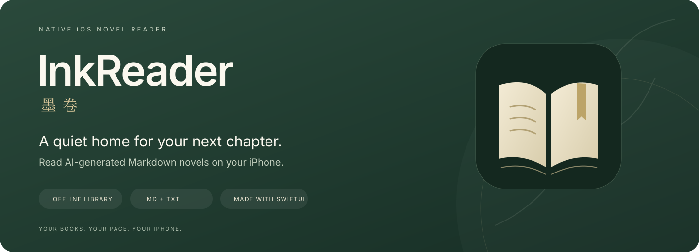
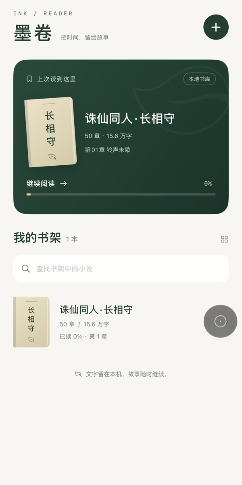
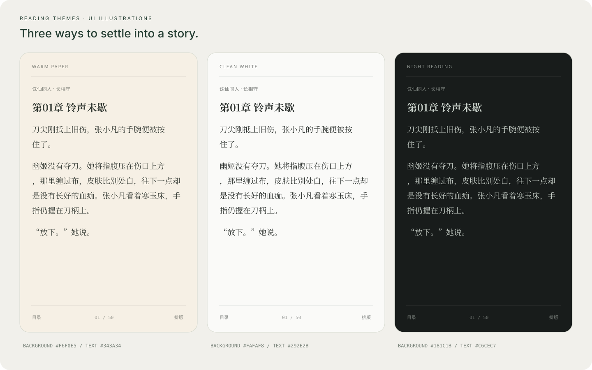
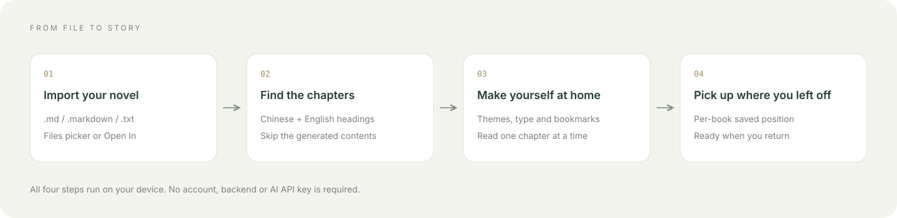

# 墨卷 · iPhone 小说阅读器

[English](README.md) · **简体中文**

在 iPhone 上阅读 AI 生成的 Markdown 小说。原生 SwiftUI 界面，暖纸书页与宋体排版，所有小说和阅读记录保存在本机，无需服务器或第三方依赖。

## 界面预览

<p align="center"></p>

书架截图来自 iPhone 17 Pro Max，已裁去系统状态栏及底部手势区。默认导入《诛仙同人·长相守》，50 章，正文 156,176 字。



以上为根据当前实现的配色与阅读布局制作的主题示意图，并非真机截图。支持字号、宋体/黑体及行距调整。



## 使用

- 首次打开自动导入《诛仙同人·长相守》，共 50 章。正文来自桌面 `诛仙合集`，原文件未修改；重复 TXT 与创作规划未加入书架。
- 点击书架中的小说切换阅读；顶部卡片可继续上次阅读。
- 右上角 **＋** 从“文件”导入一个或多个 `.md`、`.markdown`、`.txt`，支持 UTF-8、带 BOM 的 UTF-16 和 GB18030。相同内容不会重复导入，单文件上限 30 MB。
- 也可从其他 App 的分享菜单中选择“墨卷”打开文档。
- 阅读时上下滑动，底部切换章节。点击正文隐藏或显示工具栏；长按选择、复制文字。
- **目录** 中可跳转章节、查看书签，左滑书签可删除；右上角书签按钮记录当前章节与位置。
- **搜索** 按关键词搜索全书，结果按章节显示，点击后定位到该章首个匹配处并高亮。
- **排版** 调整 16–32 号字、宋体/黑体、三档行距、暖纸/素白/夜读，或开启阅读时屏幕常亮。
- 自动保存每本小说的章节、章内滚动位置及全局排版设置，重新打开后恢复。导入书籍长按可从书架删除；原文件不受影响。

## 开发与安装

打开 `InkReader.xcodeproj`，选择 `InkReader` Scheme 和连接的 iPhone 运行。最低系统 iOS 17；项目使用 Swift 5 语言模式，已在 Xcode 27.1 编译。

项目默认开发团队为当前电脑已有的 `LA5VS444F2`，Bundle ID 为 `com.edy.inkreader`。换电脑时，在 Xcode 的 **Signing & Capabilities** 选择自己的开发团队。

连接并解锁 iPhone，双击项目内 `安装到iPhone.command` 可重新编译、安装并启动。默认目标为本次连接的 iPhone 17 Pro Max，也可指定设备：

```sh
./scripts/install_iphone.sh <iPhone-UDID>
```

构建产物在 `build/Device/Build/Products/Release-iphoneos/InkReader.app`，日志在 `build/device-build.log`。开发签名到期后需重新签名安装。

## 结构

```text
InkReader/
  Core/                章节识别、Markdown 渲染（可单独测试）
  Views/               书架、阅读页、目录、搜索与排版
  LibraryStore.swift   本地导入、书架、进度、书签、设置
  Resources/           默认小说正文
  Assets.xcassets/     图标与颜色
InkReaderUITests/      真机界面测试源码
Tests/                核心解析与渲染测试
scripts/              工程生成、图标生成、真机安装
```

章节识别支持中文“第 N 章/回/节/卷/部/篇”和英文 Chapter，优先采用章节编号，忽略 Markdown 目录与代码块中的标题；没有编号时按同级标题分章，没有标题时作为一章全文阅读。渲染支持标题、段落、加粗、斜体、删除线、引用、列表、分割线和代码块。文档中的 HTML 会转义，外部链接只显示文字，图片显示替代文字。

数据在 App 的 `Documents/InkLibrary/` 中，导入文件先复制再读取，不依赖原文件位置；可通过 Finder 文件共享备份该文件夹。卸载 App 会删除本机数据。

## 验证

运行核心测试：

```sh
swift test --scratch-path build/CoreTests
```

包含默认小说 50 章、TXT 中文章节、英文与全角数字、代码块和 YAML 前置信息、普通 Markdown、HTML 转义及渲染测试。Xcode 的 `InkReaderUITests` 包含章节、排版、书签、搜索和重启恢复流程，可选择真机执行。

如增加 Swift 文件后需要重新生成工程：`python3 scripts/create_project.py`。工程生成脚本只使用 Python 标准库，不需要 CocoaPods、XcodeGen 或网络下载。
